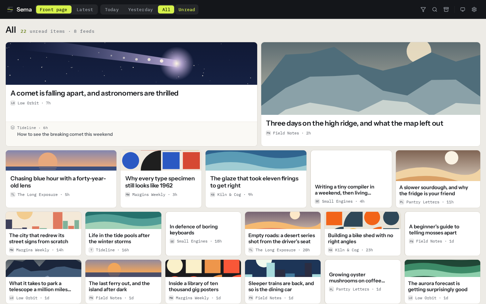

# Sema

Sema is a cloud feed reader built for triage first. A fast, keyboard-driven grid makes the Items you are most likely to care about physically larger. Anything you don't keep expires seven days after it was published, and Kept Items move to a permanent Archive.



## Highlights

- Read RSS, Atom, JSON Feed, YouTube, and Reddit through one Connector interface.
- Import and export subscriptions as OPML.
- Triage from the keyboard on a justified grid where each cell's Size follows its predicted interest.
- Rank Items with Signals (Boost, Bury, Keep), Behaviour, and Bedrock text and image embeddings.
- See one Story on the Front Page when several Feeds cover the same thing.
- Search live and Kept Items by keyword, by meaning, and by image content.
- Send any Item to an HTTPS Destination you choose, as a signed request.
- Install the SolidJS frontend as a PWA on desktop or mobile.

## How it works

```text
                                 INGESTION
                                 =========

  EventBridge, every minute
        |
        v
  +-------------+
  |  scheduler  |  claim due Feeds, 5-min lease ----> DynamoDB
  +------+------+
         | one job per due Feed
         v
  [ feeds SQS ] --> DLQ
         |
         v
  +-------------+
  | feed-worker |  fetch through the Feed's Connector:
  |             |    RSS / Atom / JSON Feed, YouTube, Reddit
  |             |  drop seen and out-of-window Items
  |             |  update Cadence, Feed Status -----> DynamoDB
  |             |  cache favicon -------------------> S3 content
  +------+------+
         | one job per new Item
         v
  [ items SQS ] --> DLQ
         |
         v
  +-------------+
  | item-worker |  extract, cache body + images ----> S3 content
  |             |  summarize junk summaries --------> Bedrock Nova Micro
  |             |  embed text ----------------------> Bedrock Titan Text v2
  |             |  embed lead image, not video -----> Bedrock Titan Multimodal
  |             |  write vectors, join a Story -----> S3 Vectors: items, images
  |             |  score, write Item ---------------> DynamoDB
  +-------------+


                             SERVING AND TRIAGE
                             ==================

  browser: SolidJS PWA
        |  Google sign-in once -> 30-day HttpOnly session cookie
        v
  +------------+  app bundle ---------------------> S3 app
  | CloudFront |  bodies, images, Archive ---------> S3 content
  |            |    (short-lived signed cookies)
  +-----+------+
        | /api/*
        v
  +------------+
  |  HTTP API  |  Items, Stories, Feeds, Read, ----> DynamoDB
  |     |      |    Signals, Behaviour, OPML
  |     v      |  search, similar Items -----------> S3 Vectors + Bedrock
  | api Lambda |  Send, first attempt inline ------> Destination
  |            |    retries -> [ deliveries SQS ] -> delivery-worker
  |            |  re-rank on demand ---------------> rescore
  +------------+


                             RANKING AND EXPIRY
                             ==================

  EventBridge, daily 09:00 UTC ---> rescore
      rebuild each user's taste from Signals, Behaviour, and text and
      image vectors; re-rank live Items; recompute Size cutoffs;
      consolidate Stories

  EventBridge, Sundays -----------> vector-cleanup
      delete vectors of Items past their Live Window

  Live Window   DynamoDB TTL + S3 lifecycle drop unkept Items
                seven days after publication
  Keep          copies the Item, its body, and its images into the
                Archive, which never expires
```

The repository has seven Go Lambda functions, shared packages under `internal/`, a SolidJS/TypeScript PWA in `web/`, and a Pulumi Go project in `infra/` that provisions the AWS stack. Everything lives in one DynamoDB table. Each queue has its own dead-letter queue and alarm, and its consumer is safe to retry. DynamoDB TTL and S3 lifecycle rules enforce the Live Window. Kept Items and Signals never expire; Behaviour expires after 90 days.

## Cadence and refusals

Each Feed has a Cadence: how often Sema checks it. Cadence follows the Feed's own publish rate rather than a fixed default. Most subscribed Feeds publish less than one Item a day while a few publish dozens, and checking every one of them hourly spent most of the fetch budget on Feeds that had nothing new.

Sema counts the new Items each Feed brought over the last seven UTC days, today included. That count is recomputed after every successful fetch, including fetches where the Feed was unchanged, and sets the Cadence:

| New Items in the last seven days | Cadence |
|---|---|
| 28 or more (four or more a day) | hourly |
| 10 to 27 | every three hours |
| 3 to 9 | every six hours |
| fewer than 3 | daily |

New Feeds start hourly for their first week. A quiet Feed that gets busy speeds up on the first fetch that takes its count past a threshold. The user can pin any Feed to a fixed Cadence, and Reddit Feeds keep the Cadence their collection implies. The trade-off is deliberate: a Feed that publishes rarely may be seen up to a day late.

A Refused fetch is not a Feed error. Examples are a 429 from any source, and the 404s and 500s YouTube returns when it throttles feed readers. A refusal never slows or breaks the Feed. Sema retries at the time the source's `Retry-After` header gives. Without that header, it retries after one Cadence period or six hours, whichever is shorter, plus up to five minutes of jitter, so the retry lands outside the source's burst window. Only a Feed refused continuously for a day is shown as broken, and Sema keeps retrying it on the same schedule.

## Connectors

Each Connector implements the shared `internal/connector.Connector` interface and is registered by name in the feed worker. RSS, Atom, and JSON Feed share the generic parser. YouTube and Reddit add their own discovery and Item metadata, and every other path is shared: scheduling, deduplication, ranking, retries, retention, and the Archive.

The Reddit Connector uses only Reddit's public Atom feeds. There is no Reddit API, OAuth, login, credential, or third-party service. Discovery accepts `r/name`, full subreddit URLs, and supported subreddit feed URLs, and stores the chosen collection as a canonical Feed URL:

- Hot: `/r/<subreddit>/.rss`, fetched every three hours.
- Top · day: `/r/<subreddit>/top.rss?t=day`, fetched daily.
- New: `/r/<subreddit>/new.rss`, fetched hourly.

Scheduled and discovery requests send the fixed `User-Agent: linux:sema:rss`. Each Feed keeps a stable offset within its Cadence and its own exponential backoff after errors, so a Reddit failure affects only that Feed.

Reddit Items keep the thread permalink separate from any external article or media link:

- **Link posts** go through the normal article extraction and open in the reader.
- **Text posts** render the sanitized selftext the Atom feed already carries.
- **Image and gallery posts** render in the reader with a cached lead image.

For Reddit's own preview thumbnails, Sema prefers the full-size `i.redd.it` image and keeps the signed Atom thumbnail as a fallback. For galleries, it recovers missing image details from the post's own public Atom feed. Reddit-hosted video stays external, because `v.redd.it` serves it as separate audio and video streams. The message-square action on every Reddit cell opens the comment thread externally. Titles and cleaned excerpts are embedded and ranked like any other Item.

## Send

Send pushes one Item, on demand, to an HTTPS address the user chooses under "Send to…" in Feeds & settings. Sema signs every request with the user's secret so the Destination can verify it; what the Destination does with the Item is up to it. Once a Destination is saved and enabled, Send is available from the reader, from the grid action sheet, and with the `s` key.

The first attempt runs while the user waits, so the toast reports what the Destination actually answered. Retryable failures (timeouts, network errors, `429`, `5xx`) get three more attempts through the deliveries queue, and Settings shows the latest result. Each user may make 60 Sends and tests an hour. Outbound requests refuse private and loopback addresses and never follow redirects. The payload is a versioned public contract; see `docs/adr/0001-send-public-webhook-contract.md`.

## Prerequisites

- Go 1.26.10+. `make lambdas` builds with the `toolchain` version in `go.mod`, which is what CI uses, and downloads it on first use.
- Bun 1.4.4 and Node.js 24, the versions CI uses.
- The Pulumi CLI 3 and the AWS CLI.
- `zip` and `sha256sum` on `PATH`.
- An AWS account in `us-east-1`, with Bedrock model access to:
  - `amazon.titan-embed-text-v2:0`
  - `amazon.titan-embed-image-v1`
  - `amazon.nova-micro-v1:0`
- An SNS topic named `NotifyMe` in that account for alarms. To use another topic, set `sema:alarmTopicName`.
- A Google OAuth web client ID.

Confirm AWS access with `aws sts get-caller-identity` before deploying.

## Local development

`make check` runs CI's test job: lint, formatting, vet, unit tests, the web build, and reproducible Lambda ZIPs. `make e2e` runs the Playwright specs. `make test` runs only the Go and Vitest unit tests, and `make build` produces the Lambda ZIPs and the production SPA.

To work on the frontend:

```sh
cd web
bun install --frozen-lockfile
bun run dev
```

Set `VITE_GOOGLE_CLIENT_ID` in `web/.env.local`. Vite proxies `/api` to `SEMA_API_ORIGIN`, or to `http://localhost:8787` when that is unset. The API runs only as a Lambda, so nothing in this repository listens on that port. See [AGENTS.md](AGENTS.md) for linting, formatting, test, and contribution guidance.

## Deploy

Production is the one stack, `untz/sema/prod` in Pulumi Cloud. Every green push to `master` deploys it from CI, which signs in to AWS and Pulumi Cloud through GitHub OIDC rather than with stored credentials. Its config, secrets included, lives in the `untz/sema/prod` Pulumi ESC environment, and `infra/Pulumi.prod.yaml` only imports it. [RUNBOOK.md](RUNBOOK.md) covers:

- CI deploys, deploying by hand (`make preview`, then `make deploy`), and rollback.
- The one-time setup, which `scripts/setup-deploy.sh` walks through.
- Changing config.
- Day-to-day operations.
- The migrations an older stack needs.

`pulumi up` builds the Lambdas and the SPA and provisions their AWS resources. `make deploy` runs it on the prod stack and then invalidates CloudFront. A new stack needs:

- The region and the Google client ID in its ESC environment.
- The alarm SNS topic from the Prerequisites.
- The bootstrap stack (`infra/bootstrap`), applied first. It owns the permissions boundary that every Lambda role uses.

After the first deployment, run `pulumi stack output url` and add that HTTPS origin to the Google OAuth client's **Authorized JavaScript origins**. Sign-in won't work until it is registered. The stack also exports the CloudFront URL, API endpoint, distribution ID, and storage bucket names.

### Authentication and private content

Google Identity Services is used only for the first sign-in. The API exchanges the Google ID token for a 30-day sliding session in a Secure, HttpOnly cookie, and the browser doesn't keep the Google token.

Both S3 buckets are private behind CloudFront. Article bodies, cached images, and the Archive need signed cookies, which are scoped to the user and last an hour. Authenticated API responses renew them. Pulumi generates the content-signing private key, keeps it in encrypted stack state, and passes it to the API Lambda as an environment variable.

### Custom domain

Set the hostname and, when the zone is in Route 53, its hosted-zone ID:

```sh
cd infra
pulumi env set untz/sema/prod 'pulumiConfig["sema:domain"]' reader.example.com
pulumi env set untz/sema/prod 'pulumiConfig["sema:route53ZoneId"]' Z0123456789ABCDEF
pulumi up
```

Pulumi requests and validates the certificate, configures the CloudFront alias, and creates A and AAAA records. The default `*.cloudfront.net` URL keeps working.

If your DNS is hosted elsewhere, omit `sema:route53ZoneId`:

1. Deploy only the `domain-certificate` target.
2. Publish the validation CNAME the stack exports.
3. Run the full update.
4. Point a subdomain at `dnsCnameTarget` with a CNAME. An apex domain needs your DNS provider's ALIAS or ANAME record instead.

After DNS resolves, add the custom HTTPS origin to the Google OAuth client. Keep the CloudFront origin registered until installed PWAs have moved to the custom domain.

## License

Sema is licensed under the [Apache License 2.0](LICENSE).
